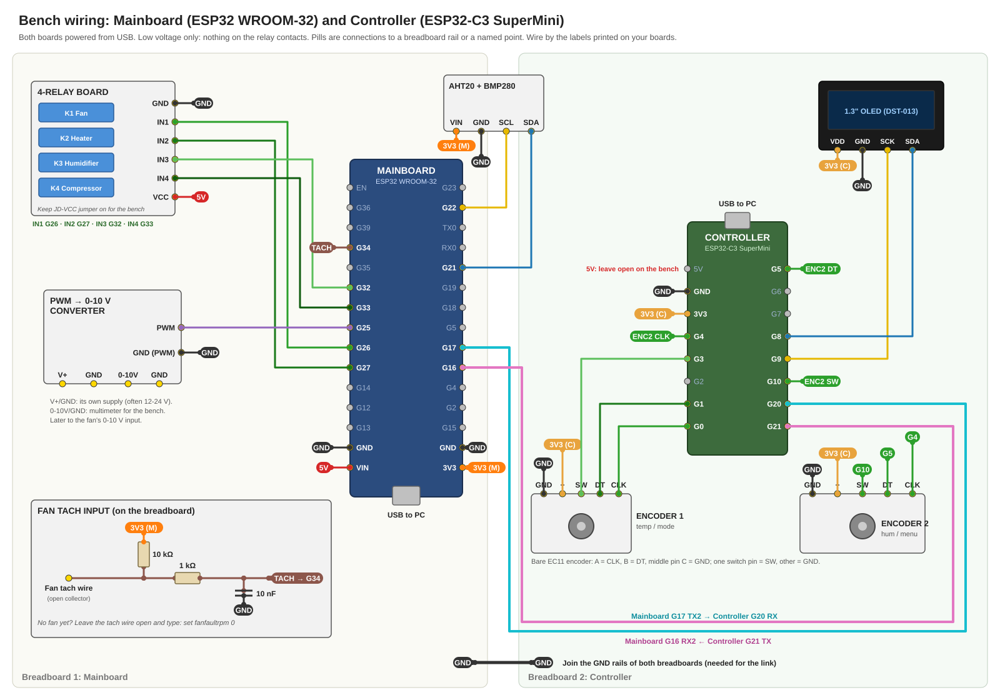

# Bench setup: wiring and flashing (Windows 11)

How to wire the Mainboard and the Controller on breadboards, flash both from a Windows 11 PC, and check that they work. **This is for low-voltage bench testing only. Do not connect anything to the relay contacts.**



The diagram is `docs/bench-wiring.svg`, made by `tools/make_bench_diagram.py`. Open it in a browser to zoom in. If you change a pin in `config.h`, change that script and run it again.

## What you need

| Item | Notes |
|---|---|
| ESP32 NodeMCU WROOM-32 DevKit (Mainboard) | 30-pin or 38-pin. Wire by the GPIO labels printed on the board |
| ESP32-C3 SuperMini (Controller) | |
| 2 breadboards | A full-size breadboard for the ESP32. It is wide, so a single breadboard often leaves only one row of holes free on one side. Two breadboards side by side, or one with the ESP32 straddling the gap between them, works best |
| 4-relay board (5 V coils, opto-isolated) | |
| AHT20 + BMP280 board | |
| 1.3" I2C OLED (DST-013) | Pins VDD, GND, SCK, SDA |
| 2 rotary encoders with push switch | KY-040 style modules, or bare EC11 |
| PWM to 0-10 V converter | Optional on the bench. Needs its own supply, often 12-24 V |
| 10 kΩ, 1 kΩ resistors, 10 nF capacitor | For the tach input. Optional until the fan is connected |
| Jumper wires, 2 USB cables | Use **data** cables: some cheap cables only carry power |
| Multimeter | To check the 0-10 V output |

## Power on the bench

- Each board is powered from its own USB cable.
- **Do not connect the Controller's 5V pin to the Mainboard while both are on USB.** The two USB supplies would be connected together. The 5 V wire in the link cable is only for the final build, when the Controller has no USB cable.
- **Join the GND of both breadboards with one wire.** The link does not work without a shared ground.
- Keep the two 3.3 V rails separate. On the diagram, `3V3 (M)` is the Mainboard's 3V3 pin and `3V3 (C)` is the Controller's.
- The relay board's coils run from the Mainboard's VIN pin (USB 5 V). Four relays at once draw about 300 mA, which with the ESP32 is close to what a USB 2.0 port gives. If the Mainboard resets when relays click, use a powered USB hub, or a separate 5 V supply for the relay board, with its GND joined to the Mainboard GND.

## Wiring checklist

Tick each wire off as you fit it. "G26" means GPIO 26.

### Breadboard 1: Mainboard

| From (Mainboard) | To | Wire colour on the diagram |
|---|---|---|
| GND | GND rail (−) | black |
| 3V3 | 3V3 rail (+), "3V3 (M)" | orange |
| VIN | Relay board VCC | red |
| GND rail | Relay board GND | black |
| G26 | Relay board IN1 (Fan) | green |
| G27 | Relay board IN2 (Heater) | green |
| G32 | Relay board IN3 (Humidifier) | green |
| G33 | Relay board IN4 (Compressor) | green |
| 3V3 rail | Sensor VIN | orange |
| GND rail | Sensor GND | black |
| G22 | Sensor SCL | yellow |
| G21 | Sensor SDA | blue |
| G25 | Converter PWM input (optional) | purple |
| GND rail | Converter PWM GND (optional) | black |
| G34 | Tach input circuit (optional, see below) | brown |

**Relay board:** leave the JD-VCC jumper on. Most boards switch a relay on when IN is pulled LOW, which matches the firmware default. If a relay will not switch off, or its LED glows faintly, the 3.3 V signal is not quite enough for the board: remove the JD-VCC jumper, power JD-VCC from VIN (5 V) and VCC from 3V3.

**PWM to 0-10 V converter (optional):** connect its supply (V+ and GND, often 12-24 V), and put a multimeter on its 0-10V and GND output pins. Some converters ignore a 3.3 V PWM signal. If yours stays at 0 V with the fan on, it needs a transistor or level shifter between them.

**Tach input (optional):** from the fan's tach wire, fit 10 kΩ to the 3V3 rail and 1 kΩ in series to G34. Then fit 10 nF from G34 to GND. Never pull the tach up to 5 V or more. With no fan yet, leave G34 unconnected and turn the fan fault check off (see "First checks" below).

### Breadboard 2: Controller

| From (Controller) | To | Wire colour on the diagram |
|---|---|---|
| GND | GND rail (−) | black |
| 3V3 | 3V3 rail (+), "3V3 (C)" | orange |
| 5V | **Nothing** (on the bench) | |
| 3V3 rail | OLED VDD | orange |
| GND rail | OLED GND | black |
| G9 | OLED SCK | yellow |
| G8 | OLED SDA | blue |
| G0 | Encoder 1 CLK (A) | green |
| G1 | Encoder 1 DT (B) | green |
| G3 | Encoder 1 SW | green |
| G4 | Encoder 2 CLK (A) | green |
| G5 | Encoder 2 DT (B) | green |
| G10 | Encoder 2 SW | green |
| GND rail | Both encoders' GND | black |
| 3V3 rail | Both encoders' "+" (modules only) | orange |

**Encoders:** on a KY-040 style module, connect "+" to **3V3**, never 5 V. A bare EC11 encoder has no "+": A is CLK, B is DT, the middle pin C goes to GND, and one switch pin goes to SW and the other to GND.

### Between the two breadboards

| Mainboard | Controller | Notes |
|---|---|---|
| G17 (TX2) | G20 (RX) | TX goes to RX |
| G16 (RX2) | G21 (TX) | RX goes to TX |
| GND rail | GND rail | Needed for the link |

G4 (Mainboard) and G7 (Controller) stay unconnected until the RS-485 modules are fitted.

## Flashing on Windows 11

### 1. Install the tools (once)

1. Install **Visual Studio Code** from code.visualstudio.com.
2. Open VS Code, click the **Extensions** icon on the left (four squares), search for **PlatformIO IDE**, and click **Install**.
3. Wait until PlatformIO says it has finished installing (watch the bottom-right corner), then restart VS Code when it asks. An ant-head icon appears on the left bar.
4. Install a USB driver for the Mainboard. Check which USB chip it has: it is the small chip next to the USB socket.
   - **CP2102** or **CP2104**: install the "CP210x Universal Windows Driver" from Silicon Labs.
   - **CH340** or **CH9102**: install "CH341SER" from WCH.
   - The ESP32-C3 SuperMini needs no driver.

### 2. Get the code

The code is on the branch `claude/youthful-hypatia-n9k5yy` of the GitHub repository, until it is merged into the main branch.

- **With Git** (from git-scm.com), in PowerShell:

  ```bash
  git clone -b claude/youthful-hypatia-n9k5yy https://github.com/josh-dell-marketing/esp32-climate-controller.git
  ```

- **With GitHub Desktop:** File → Clone repository, pick `esp32-climate-controller`, then choose the branch `claude/youthful-hypatia-n9k5yy` from the **Current branch** menu.

- **As a ZIP:** on GitHub, switch to that branch, then **Code → Download ZIP**, and unzip it. A short path with no spaces is safest, for example `C:\projects\esp32-climate-controller`.

### 3. Open the project

1. In VS Code: **File → Open Folder**, and choose the `esp32-climate-controller` folder (the one with `platformio.ini` in it).
2. If VS Code asks whether you trust the authors, click **Yes**.
3. PlatformIO starts downloading the ESP32 tools the first time. This takes a few minutes. Wait for it to finish.

### 4. Build both firmwares (no boards needed)

1. Click the PlatformIO (ant-head) icon on the left.
2. Under **PROJECT TASKS** there are two environments: **mainboard** and **controller**.
3. Expand **mainboard → General → Build**. The terminal should end with `SUCCESS`.
4. Do the same for **controller → General → Build**.

### 5. Flash the Mainboard

1. Plug in **only the Mainboard** with its USB cable.
2. Open **Device Manager** (right-click Start → Device Manager), expand **Ports (COM & LPT)**, and note the new port, for example `Silicon Labs CP210x USB to UART Bridge (COM5)`. If nothing appears, the driver is missing or the cable is power-only.
3. In PlatformIO: **mainboard → General → Upload**.
4. If the terminal stops at `Connecting........_____`, hold the board's **BOOT** button until the upload starts, then let go.
5. When it says `SUCCESS`, press the board's **EN** (reset) button.
6. Click **mainboard → General → Monitor**. You should see:

   ```
   === Climate controller: Mainboard ===
   [sensor] AHT20 found at 0x38
   [sensor] BMP280 found
   ```

   Type `status` and press Enter. Close the monitor with the bin icon on the terminal (or Ctrl+C) before uploading again: the monitor holds the COM port.

### 6. Flash the Controller

1. Plug in the Controller (you can leave the Mainboard plugged in, see step 7).
2. In Device Manager a new port appears, for example `USB Serial Device (COM7)`.
3. In PlatformIO: **controller → General → Upload**.
4. If it cannot connect: hold the SuperMini's **BOOT** button, tap **RESET**, let go of BOOT, and click Upload again. After the upload, press **RESET** to start the new firmware. (The COM port number can change while it is in download mode.)
5. The OLED shows "Climate Controller", then the home screen, or **NO LINK TO MAINBOARD** if the Mainboard is not running or the link is not wired.
6. **controller → General → Monitor** shows `=== Climate controller: Controller ===` and `[link] Mainboard connected` once the link works.

### 7. With both boards plugged in

PlatformIO picks a COM port by itself, and with two boards it may pick the wrong one. Tell it which port to use. Open a PlatformIO terminal (PlatformIO icon → **QUICK ACCESS → Miscellaneous → New Terminal**), then use the COM numbers from Device Manager:

```bash
pio run -e mainboard -t upload --upload-port COM5
```

```bash
pio run -e controller -t upload --upload-port COM7
```

```bash
pio device monitor -e mainboard --port COM5
```

In an ordinary PowerShell window `pio` is not on the PATH. Use `%USERPROFILE%\.platformio\penv\Scripts\pio.exe` there instead, or the PlatformIO terminal.

### Troubleshooting

| Problem | Fix |
|---|---|
| No COM port appears | Try another cable (it may be power-only) and another USB port. Install the CP210x or CH340 driver for the Mainboard |
| `Failed to connect to ESP32: No serial data received` | Hold BOOT during "Connecting..." (Mainboard), or do the BOOT + RESET sequence (Controller) |
| `Could not open port ... Access is denied` | Something else has the port open: close the serial monitor, the Arduino IDE or any other terminal |
| Upload goes to the wrong board | Use `--upload-port` as in step 7 |
| Controller monitor shows nothing | Press RESET once after opening the monitor. The first messages print before Windows has opened the port |
| OLED blank | Check VDD on 3V3, SDA on G8, SCK on G9. Try swapping SDA and SCK if unsure of the labels |
| OLED picture shifted or noisy | It is an SSD1306: uncomment `#define OLED_SSD1306` in `src/controller/config.h` and upload the Controller again |
| "NO LINK TO MAINBOARD" | Check TX→RX crossed both ways and the GND wire between the breadboards. Check the Mainboard is running (its monitor prints messages) |

## First checks

Do these in order. Use the Mainboard's serial monitor (type `help` for the list) or the Controller.

1. **Sensor:** type `status`. You should see a temperature and humidity. Breathe on the sensor: the humidity rises.
2. **No fan yet?** Type `set fanfaultrpm 0`. Otherwise a fan fault appears 25 s after the fan relay turns on.
3. **Link and display:** the Controller's home screen shows the same temperature and humidity.
4. **Encoders:** turn encoder 1: the temperature set point changes (shown inverted until the Mainboard accepts it). Turn encoder 2: the humidity set point changes. If a knob works backwards, set `ENC1_REVERSE` / `ENC2_REVERSE` in `src/controller/config.h`. If one click moves two steps, or two clicks move one step, change `ENC_STEPS_PER_DETENT`.
5. **Relays:** push encoder 1 until the mode shows **Manual**. Long-push encoder 2 for the menu, and switch each "Man:" item on and off with encoder 1. Each relay should click and its LED light. From the serial monitor: `mode manual`, then `relay 1 on`, `relay 1 off`, and so on.
6. **0-10 V output (if wired):** with the fan relay on, the multimeter reads about 10 V. Set the fan speed to 50 % in the menu (or `set fanspeed 50`): it reads about 5 V. With the fan relay off it reads 0 V. If the readings are off, adjust `FAN_PWM_DUTY_AT_0V` and `FAN_PWM_DUTY_AT_10V` in `src/mainboard/config.h`.
7. **Control rules:** run the test list in `PLAN.md` section 4 with the simulated sensor (`sensor sim`, then `temp 22.6`, `hum 54` and so on, or the Sim items in the Controller's menu). Set `set compminoff 0` and `set compminon 0` so you don't have to wait for the compressor timers.
8. **Link loss:** pull the TX or RX wire. Within 5 s the Controller shows NO LINK TO MAINBOARD, and the Mainboard carries on. Put it back: the Controller recovers.

Finish with `mode off`, and set the compressor times back (`set compminoff 180`, `set compminon 60`).
